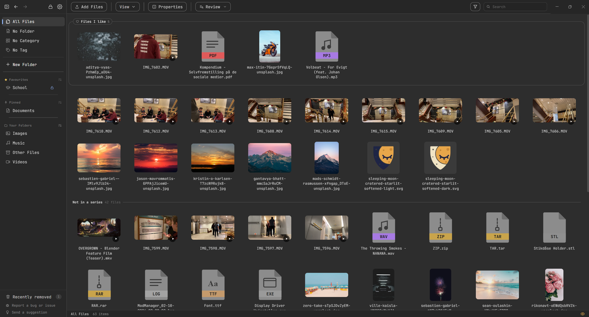
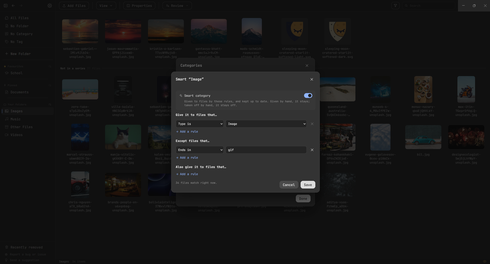
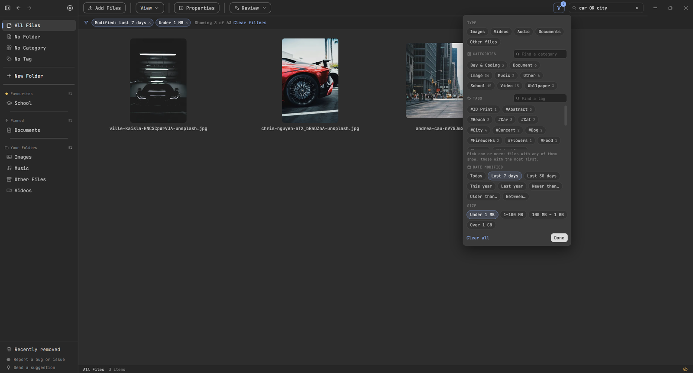
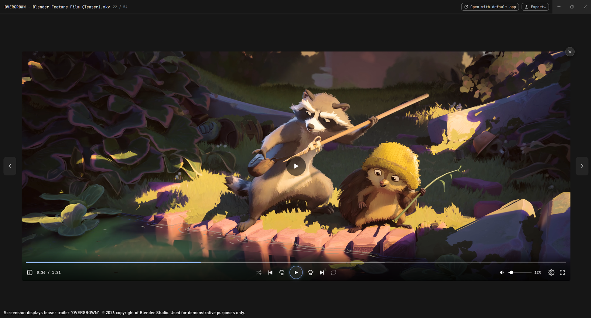
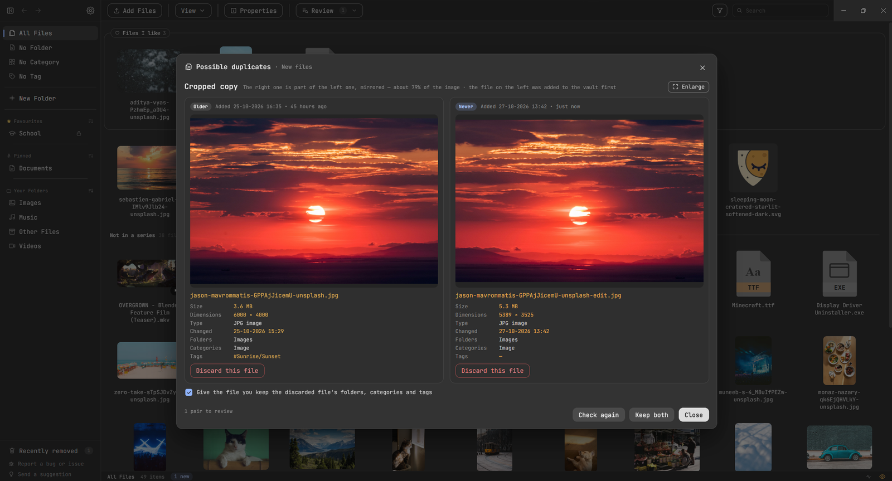
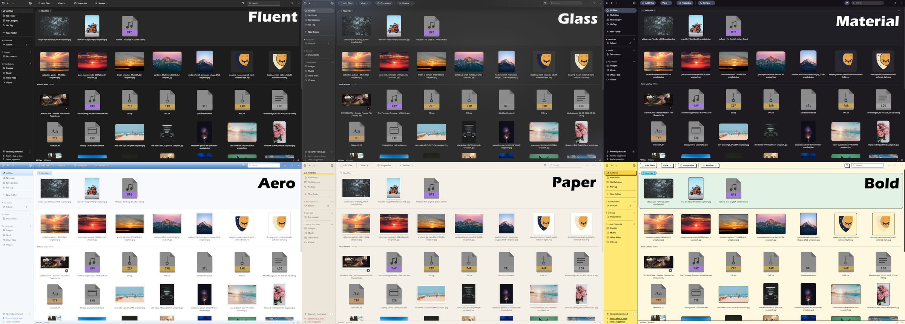
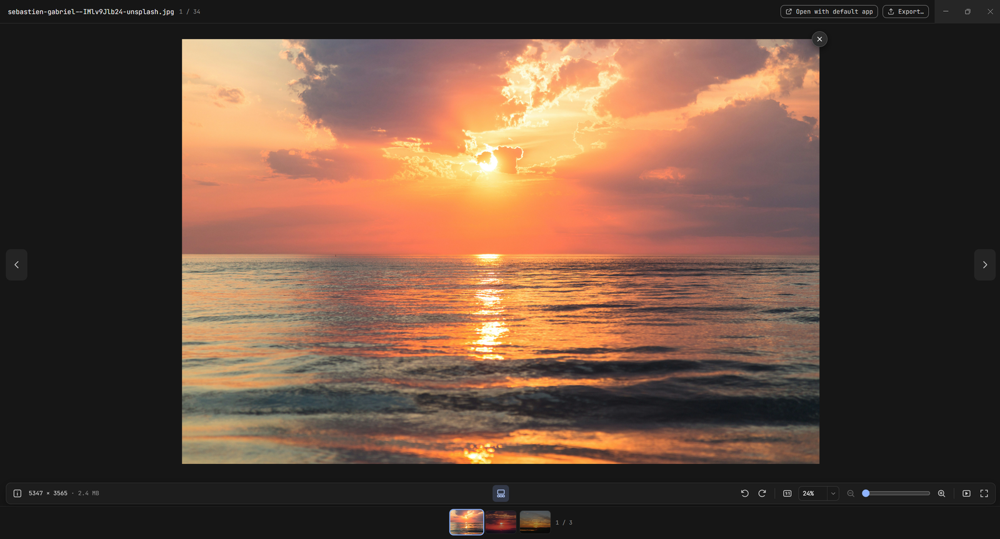
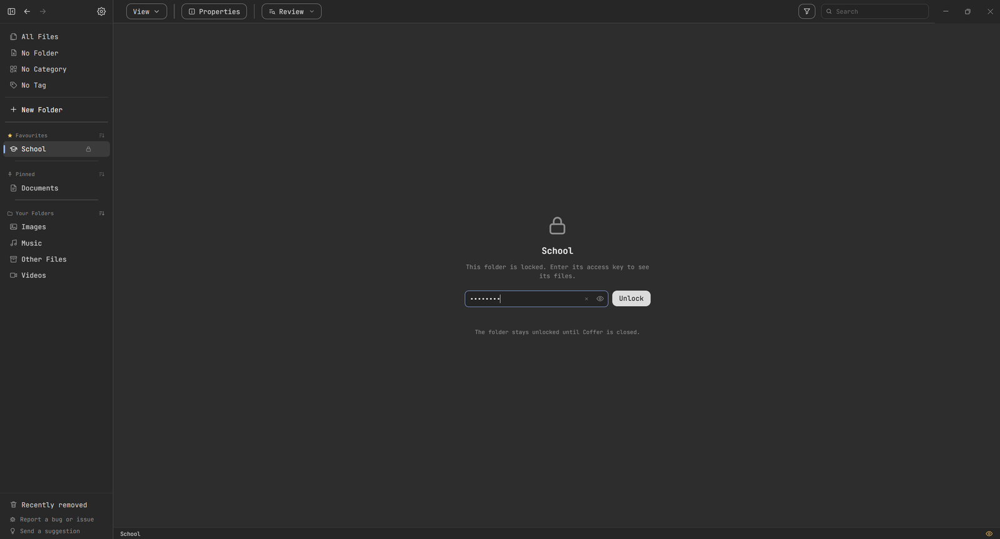
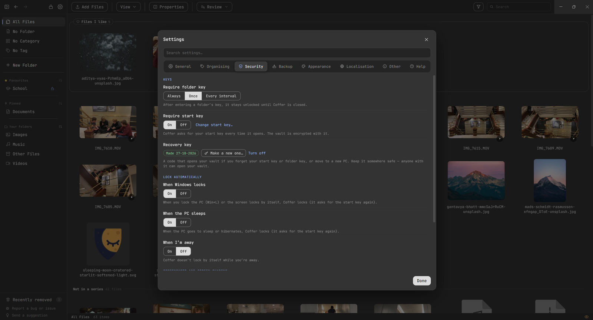
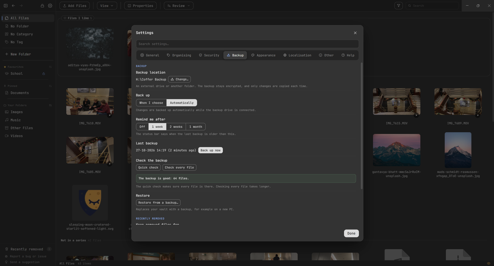

# Coffer

**A private, encrypted home for your files, images and videos — that also makes them easy to find.**

For Windows 11 (and 10) and 64-bit Linux. No account and no cloud: everything stays on your own PC.

## Why Coffer?

A normal folder on your PC is open to anyone who uses it, and a big collection quickly gets hard to search through, because every file can only sit in one folder. Coffer solves both:

- **Private.** Files you add are encrypted (AES-256) and can only be opened through Coffer. Lock the whole app with a start key, or just some folders with their own keys.
- **Easy to find.** A file isn't stuck in one place. Give it any number of folders, categories and tags, and find it again by any of them — or by search, filters, date, or what it looks like.
- **Offline.** The only time Coffer goes online is to check this page for updates, and you can turn that off.

## What you could use it for

- **Private images and videos** you don't want to show up when someone borrows your PC or you share your screen.
- **Important documents** like ID scans, contracts, bank papers and school work.
- **Big collections** — art, wallpapers, memes, game screenshots or reference images — sorted by what they are (a category like *Wallpaper*, tags like *#Sunset* and *#Beach*) instead of crammed into one folder tree.
- **Cleaning up years of downloads:** Coffer finds duplicates, even edited copies, so you keep just one of each.

## What it does

### Keeps your files safe
- An optional **start key** for the whole app, and **access keys** for single folders.
- **Locks by itself** when Windows locks, the PC sleeps, or you've been away for a while.
- **Hides from screenshots and screen sharing** (Windows only), until you choose to show it.
- A **recovery key** that opens your vault if you forget a key or move to a new PC.
- **Encrypted backups** to any drive, automatic if you like, with only changes copied each time.
- **Recently removed** and **Undo**, so nothing is gone by accident.

### Organises without forcing one folder
- Folders, categories and tags — as many per file as you like.
- **Smart categories and tags** give themselves to the files that match your rules (for example: every image, except GIFs) and stay up to date.
- **Tag suggestions** learned from the tags you've already given. Coffer only suggests; it never tags anything by itself.

### Finds things fast
- Search by name, category or tag (`car OR city` works too), and filter by type, date, size, category or tag.
- Sort by name, date, size or type — or by **Similar**, which puts look-alike images and videos next to each other.

### Opens files without leaving copies
- Images, videos, music, PDFs and text open in Coffer's own viewers, decrypted only in memory. Zoom, rotate, play, loop, go full screen, or start a **slideshow**.
- Other files open in their own program through a temporary copy that is wiped afterwards.

### Cleans up duplicates
- Found when you add files or whenever you ask — including resized, cropped, mirrored or edited copies and shortened videos.
- Compare each pair side by side and choose what to keep. Nothing is deleted without you.

### Looks the way you like
- **10 designs** — Classic, Fluent, Adwaita, Glass, Material, Aero, Terminal, Paper, Bold and Launcher — each with its own themes, plus accent colours and animations.

More screenshots

## Install

**Windows:** download `Coffer-Setup-<version>.exe` from the newest release under **Releases** and run it. It installs for your Windows user only, without admin rights.

**Microsoft Store:** Coffer is also on the Microsoft Store (search for *Coffer* by Sleeping Shield Studio). The Store keeps it up to date, but gets new versions a little later than this page.

**Linux** (64-bit): pick one from the newest release.

- `coffer_<version>_amd64.deb` for Ubuntu, Debian, Linux Mint, Pop!_OS and others based on them: open it with your software installer, or run `sudo apt install ./coffer_<version>_amd64.deb`. **Use this one on Ubuntu 24.04 and newer.**
- `Coffer-<version>.AppImage` for any other distribution: make it executable (`chmod +x Coffer-<version>.AppImage`, or Properties → Allow executing as a program) and run it. Ubuntu 24.04 and newer block the sandbox AppImages of apps like Coffer need, so the AppImage may not start there; use the .deb.

On Linux, Coffer asks you to choose a start key the first time it opens, and it can't be turned off. Hiding Coffer from screenshots and screen sharing isn't available on Linux.

## Updates

Coffer checks this page for a new version when it starts. When there is one, the gear in Coffer gets a green dot, and **Settings → General** lets you download and install it (on Linux it opens the release page, where you download the new .deb or AppImage).

## Helping the project

Found a bug, or have an idea? Click **Report a bug or issue** or **Send a suggestion** at the bottom of Coffer's side bar. It opens a form here with your Coffer version filled in, and a bug report can also add details about your PC (you see them first; never file names or keys). You can also go straight to **Issues** on this page. Every report helps make Coffer something people can rely on. I am not looking for co-developers.

## Use of AI

Coffer is developed with the help of **Claude Opus 5.5**, Anthropic's AI model. I design the app: what it does, how each feature works and how it looks, and I decide what goes into every release. Claude writes most of the code and suggests technical improvements and fixes. Every change is reviewed and tested by me before it is released.
